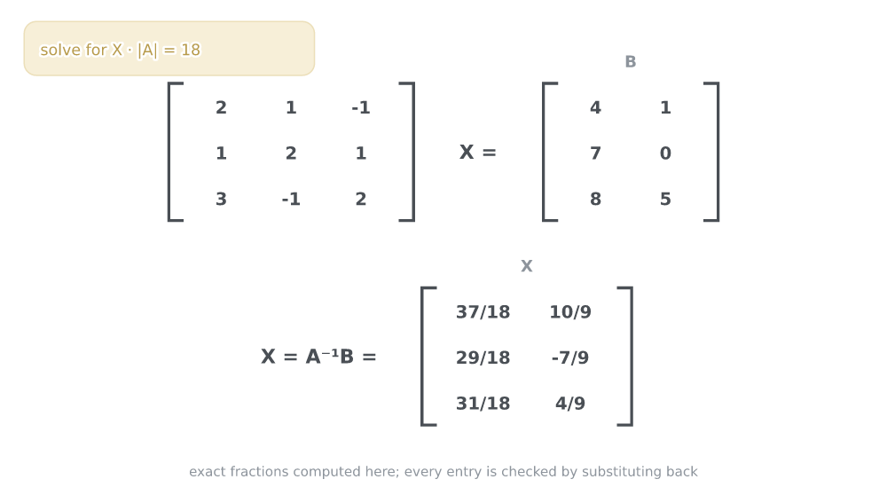

# Matrix questions — read the grid, then solve it exactly

A matrix question is a grid of numbers and one operation. Pasted out of a PDF or
read by OCR, the grid flattens:

```
Hard Matrix Question: 2 1 -1 41 : 2 1 | X = : 0]. 3 -1 2 8 5
```

A model reading that sentence cannot see a 3×3 matrix and a 3×2 matrix; in the
report that prompted this work it called them 2×2 and 2×3, then returned three
entries where X needs six. The fix cannot be "ask the model harder" — the
values are not in the text any more.

So the app reads the matrices itself, computes the answer itself, and draws the
matrices it used.



## A photo of a matrix question

`api/ai/read-image.js` used to ask for a flat transcript, which turned a printed
`AX = B` into `2 1 -1 41 / : 2 1|X= : 0]. / 3 -1 2 8 5`. Its prompt now keeps the
grid: one matrix per line in `[[row], [row]]` form, no two matrices on one line,
no digits run together, `?` for a genuinely illegible digit.

On the client, `UP.matrices.fromRows(text)` rebuilds the grid when the numbers
force one reading — A's rows and B's rows on the same visual line, or A's block
followed by B's block — and accepts the reconstruction only if it solves and the
substitution check passes. `readPhoto` swaps in that rebuilt text before it opens
the answer, so what the student sees is what was solved. A ragged paste (a digit
lost) is refused rather than guessed, and the repair card asks for the values.

`docs/question-audit.md` records how 26 question shapes are routed.

## What happens on Ask

1. **Detection by shape, not vocabulary.** A pasted
   `A = [[…]] / B = [[…]] / Find X such that AX = B.` — the form students
   actually paste — has no word *matrix* in it anywhere; requiring the word sent
   exactly that question to the model, where it timed out with "The AI took too
   long to respond". `isMatrixQuestion` now accepts a bracketed block of
   bracketed numeric rows, or two or more labelled numeric rows, as well as the
   word. Theory questions ("explain matrix multiplication") still have no
   numbers and are left to the model. The app also tries the exact solve on
   every maths question and only falls back to the repair card when the text
   *looks* like matrices but cannot be read.
0. **If the equation parses, the app answers it itself** — no provider call, no
   model prose. The answer line shows X as a drawn grid, the badge says
   *Solved by exact calculation*, and four routes (adjoint, Gauss–Jordan,
   Cramer, substitution) all come from the one exact solution. `det`, `A⁻¹` and
   `AB` (including a bare "Find AB") take the same path, with four routes each:
   two expansions / pivots / adjugate for a determinant, `[A | I]` / adjoint /
   cofactor entry / multiply-back for an inverse, and row·column / all entries /
   dimension rule / `(AB)ᵀ = BᵀAᵀ` for a product. This exists
   because the model's arithmetic on exactly this question was wrong: it wrote
   `adj(A)·B = [[18,18],[36,−18],[0,36]]` instead of `[[37,20],[29,−14],[31,8]]`
   and answered `[[1,1],[2,−1],[0,2]]`.
2. **`UP.matrices.solve(text)`** parses every bracketed block — `[[1,2],[3,4]]`,
   `[1 2; 3 4]`, `((1,2),(3,4))`, one row per line — and reads the operation
   from the words: `A X = B`, `X A = B`, `|A|`, `A⁻¹`, `AB`.
3. **If it solved**, the question is restated in an unambiguous form before
   anything else sees it:

   ```
   Find the matrix X if A X = B, where A = [[2, 1, -1], [1, 2, 1], [3, -1, 2]]
   and B = [[4, 1], [7, 0], [8, 5]].
   ```

   (If the engine could not answer for some reason, the model's prose is still
   written against that sentence and the figure is drawn from the same numbers;
   an answer that does not repeat any entry of the computed X then raises
   `worked-figure-mismatch`.)
4. **If it could not**, nothing is guessed. The student gets a card with the
   text as it was read and two grids to fill (or the `A = [1 2; 3 4]` form).
   Those values are solved and drawn, and the question is then asked normally.

## The arithmetic

Exact rational arithmetic on `BigInt` fractions, never floats:

- Gauss–Jordan elimination on `[A | B]` gives `X` for `AX = B`; `XA = B` is
  solved as `AᵀXᵀ = Bᵀ`.
- `|A|` comes from the same elimination (product of the pivots, with the sign
  of every row swap), so the determinant on the figure is the one used to
  invert.
- Every solve is verified: `A·X` (or `X·A`) is recomputed and compared with `B`
  entry by entry. `check: true` in the spec means that comparison passed.
- Answers stay exact: `37/18`, `10/9`, `−7/9` — not `2.0555555555555554`.

For the question in the report:

```
A = [[2, 1, -1], [1, 2, 1], [3, -1, 2]]       B = [[4, 1], [7, 0], [8, 5]]
|A| = 18
X = [[37/18, 10/9], [29/18, -7/9], [31/18, 4/9]]
A·X = B                                        (checked entry by entry)
```

## What is refused

- `A` not square, or `B` with the wrong number of rows (or columns for `XA`);
- `|A| = 0` — no unique solution, said plainly rather than divided by zero;
- more than four rows or columns, or a block where one row has a different
  length;
- a paste with no complete block left: that goes to the repair card, not to a
  guessed matrix.

## Where it lives

- `assets/js/matrices.js` — parser, exact solver, canonical restatement,
  figure spec.
- `assets/js/figures.js` — `matrixFig`, the bracketed grids.
- `assets/js/app.js` — `askAI` restates or asks for the values;
  `workedFigureFor` draws the matrix before any other figure family;
  `renderAnswer` renders the repair card.
- `lib/solve-policy.js` (`four-approaches-v7`) tells the model to state each
  matrix as `[[row],[row]]` with its real shape and never to restate a matrix
  it cannot read.

## Tests

- `node tools/check/matrices.js` — the exact X and |A| for the reported
  question, detection of the pasted block that has no word "matrix", the four
  answer routes (each ending at the same X), the drawn answer grid, the badge,
  the local determinant/inverse/product answers, substitution check,
  inverse/determinant/product/`XA` cases, the figure contents, and the refusals
  (singular, mismatched, unparsable, five-row blocks, non-matrix text).
- `tools/check/worked_figure_browser.js` — at 1280 px and 390 px: the matrix
  question is answered **without a provider call**, the answer line carries a
  drawn grid, the badge says the answer was computed, the figure shows
  `37/18`, a flattened paste produces the repair card with no figure, and the
  confirmed values are then solved and drawn.
