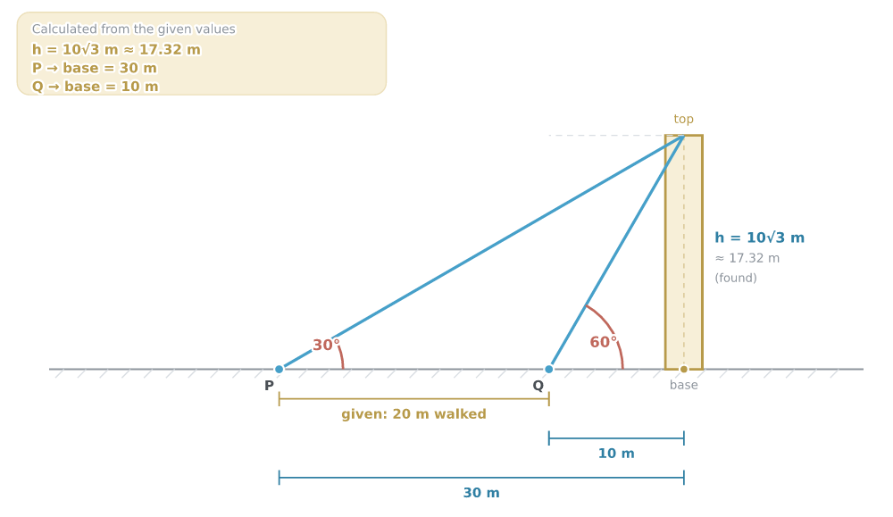
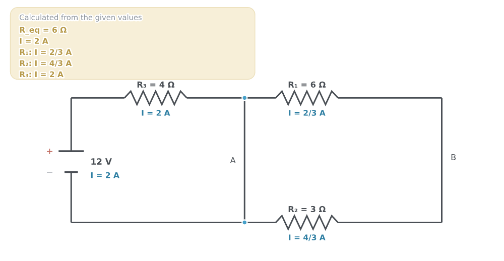
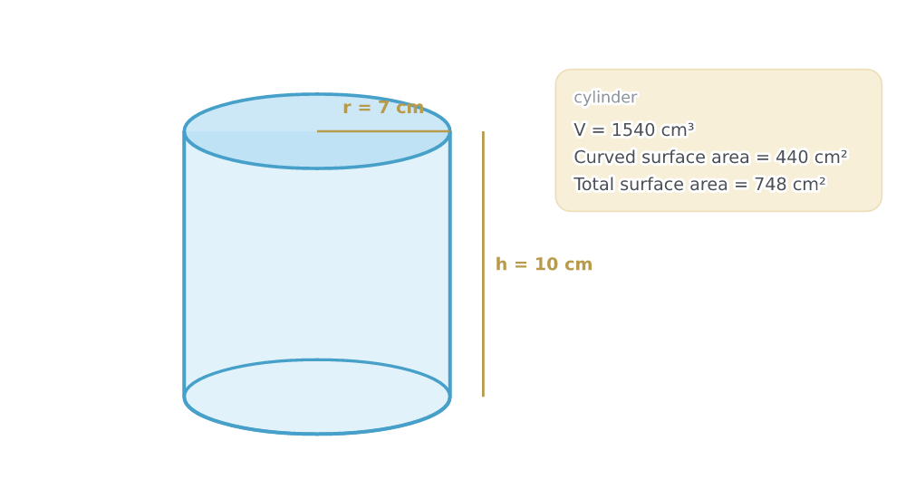
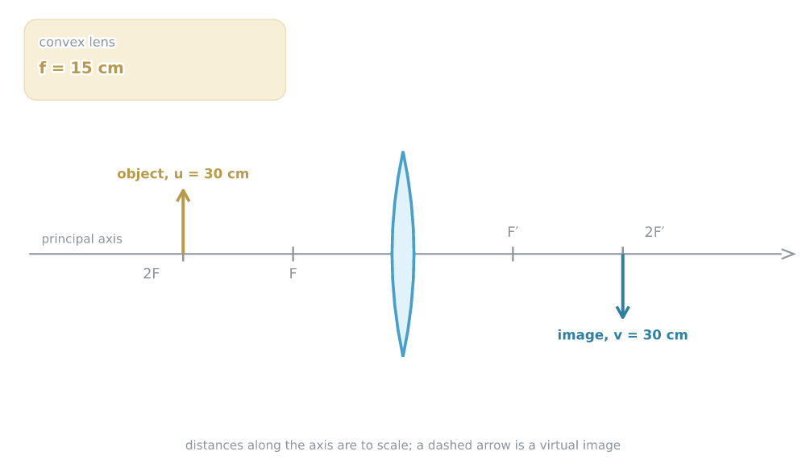

# Worked figures — a picture of the answer, not just of the question

A student typing *“From P the angle of elevation is 30°. After walking 20 m
towards the tower the angle is 60°. Find the height and the original
distance.”* already gets a correct written answer. The useful addition is a
drawing that shows **the answer on the figure**: the tower, both sight lines,
both angles, the 20 m walked, and the computed height (10√3 m ≈ 17.32 m) and
distances (30 m from P, 10 m from Q). The same applies to a 6 Ω ∥ 3 Ω pair in
series with 4 Ω across 12 V: the drawing names every resistance, the battery,
the total current and the current in each branch.

The same idea now covers five families — heights and distances, resistor
networks, mensuration solids, two points on a plane, and a lens or mirror ray
diagram. This is what `assets/js/worked-figure.js` plus the renderers in
`assets/js/figures.js` do.

## Why it is a calculator, not a drawing model

The figure is only honest if its numbers are right. So the flow has no model
in it:

1. `UP.workedFigure.forQuestion(question)` reads the question text and
   recognises one of five families.
2. It computes the answers itself (trigonometry, series/parallel arithmetic,
   the mensuration formulas, the distance formula, the lens/mirror formula).
3. It returns a spec whose labels, chip and caption come from that one
   calculation; `UP.figures.generic(spec)` draws it.

The AI's prose is never parsed for a number. Its own diagram object for these
questions is ignored: a wrong AI circuit or triangle cannot become the picture
the student studies. The written answer is still shown as usual, and if it does
not repeat the calculated height (for example the model wrote 20 m where the
question's own angles give 17.32 m) a short note says to check the answer
against the working above.

## What is supported

**Heights and distances** (`type: 'elevation'`)

| Wording | Figure |
|---|---|
| Two angles of elevation + the distance walked between two points | tower, both sight lines, both angles, the walked distance, computed height and both distances |
| One angle of elevation + the distance from the foot | tower, one sight line and angle, given distance, computed height |
| A stated height + one angle of elevation | tower labelled with the given height, computed distance to the point |

The drawing is to scale from the computed values, so the proportions agree
with the arithmetic. Depression angles, ladders, shadows, boats and two-object
questions are refused — they are different diagrams, and a flipped or
half-right picture is worse than none.

**Resistor networks** (`type: 'circuit'`, `network: true`)

- all resistors in series, or all in parallel (2 or 3 resistors);
- one parallel pair in series with a third resistor, in either word order
  (“6 Ω and 3 Ω in parallel, that combination in series with 4 Ω” or “4 Ω in
  series with a parallel combination of 6 Ω and 3 Ω”).

The drawable values are the resistances and (when given) the supply voltage.
If a supply is given, the figure also labels the equivalent resistance, the
total current and the current in each resistor; with no supply it labels only
the equivalent resistance. Four or more resistors, bridges, and questions with
capacitors, meters or internal resistance are refused.

**Mensuration solids** (`type: 'solid'`)

| Shape | What the question must give | What the figure labels |
|---|---|---|
| cylinder | radius (or diameter) and height, in one unit | r, h, V, curved and total surface area |
| cone | radius and vertical height (not slant height) | r, h, V, curved and total surface area, the derived slant height |
| sphere / hemisphere | radius or diameter | r, V, surface area (hemisphere: curved and total) |

The volume and areas are computed here, not copied from the answer, and the
quantity the question asks for is listed first. English and Hindi wording are
both read ("त्रिज्या 7 सेमी", "बिंदुओं (3, 4) और (7, 1) के बीच की दूरी",
"15 सेमी फोकस दूरी"). π is 22/7 when the radius is a
multiple of 7 or 3.5, otherwise 3.14 — unless the question states its own value.
Questions that mix units (radius in metres, height in centimetres) are refused,
and so are composite or reshaped solids: a cylinder with a conical cavity, a
sphere melted and recast, a cone on a cylinder, a frustum. Their surface area is
not the sum of the parts, and a plain cylinder drawn under such a question is a
picture of a different object.

**Two points on a plane** (`type: 'distance'`)

The two points are plotted on a grid with the right-triangle legs and the
computed `PQ`; the figcaption gives the distance and the midpoint. “Equidistant
from …”, the section formula, a ratio, three vertices, collinearity and
“distance between the points” with no coordinates are refused: each asks a
different question, and the drawing would answer the wrong one.

**Lens and mirror ray diagrams** (`type: 'optics'`)

The question must name one device (lens *or* mirror), its kind (convex or
concave), a focal length and one object distance. The figure draws the principal
axis, the lens or mirror, F and 2F (C for a mirror), the object arrow and the
computed image arrow, with `v` and `m` in the figcaption. Distances along the
axis are to scale; the arrow heights keep the magnification ratio and are
shrunk together when an enlarged image would leave the canvas, which the caption
says. A virtual image is dashed and labelled below the axis. Questions that give
the image distance and ask for the object, that place the object at the focus,
that name both a lens and a mirror, or that give two lenses in contact are
refused — each needs the formula run in the other direction.

Ambiguous or incomplete wording always returns `null`, and the answer is shown
without a picture: an unsupported component, the mirror arrangement (“6 Ω and
3 Ω in series, that pair in parallel with 4 Ω”), a missing walked distance, an
absurd proportion, a mixed network of more than three resistors, a slant height
with no vertical height, or an optical question with no stated kind.

## Where it appears

`renderAIDiagram` in `assets/js/app.js` places the figure above the written
answer with the tag “Drawn from the question’s numbers; values calculated
here”, the answer repeated in the caption, and the caption note that it is a
schematic rather than the paper’s own figure. Nothing is stored, so the figure
is regenerated identically on every render and works offline.

Repeated unit tokens from a pasted PDF (`30∘30∘`, `6 Ω6Ω`, `12 V12 V`) are
collapsed before parsing; without that, one resistor becomes two and the whole
network parse shifts.

## Tests

- `node tools/check/worked_figures.js` pins the arithmetic (10√3 m, 30 m,
  10 m; 6 Ω, 2 A, 2/3 A, 4/3 A; 1540 cm³, 440 cm², 748 cm²; PQ = 5 with
  midpoint (5, 2.5); lens v = 30 cm with m = −1, concave mirror v = −60 cm with
  m = −3, convex mirror v = 8.57 cm with m = 3/7), the labels in the SVG, the
  refusals above, and that the older two-resistor circuit and AI geometry
  renderers are unchanged.
- `tools/check/worked_figure_browser.js` (desktop and 390 px) mocks the
  provider and checks the Ask view: both figures render with their labels, a
  mismatched written answer raises the note while the figure keeps the
  calculated value, a wrong AI circuit diagram does not replace the verified
  network, and a ladder question gets no worked figure.

Both run in `.github/workflows/trust-checks.yml`. The provider is mocked in the
browser test, so it proves the drawing contract, never AI accuracy.
